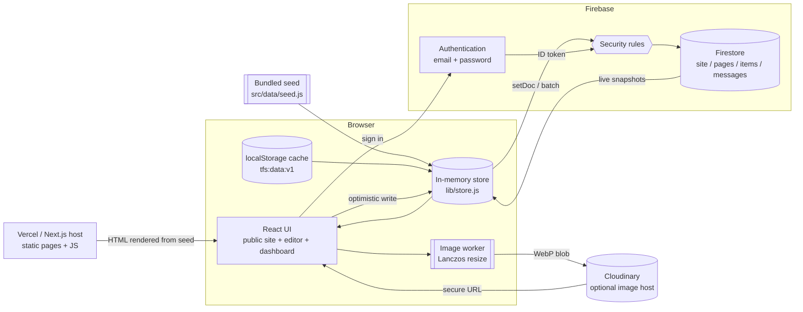
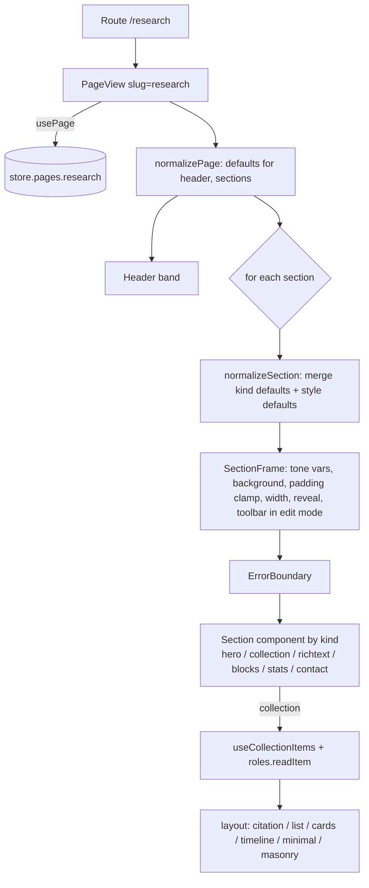
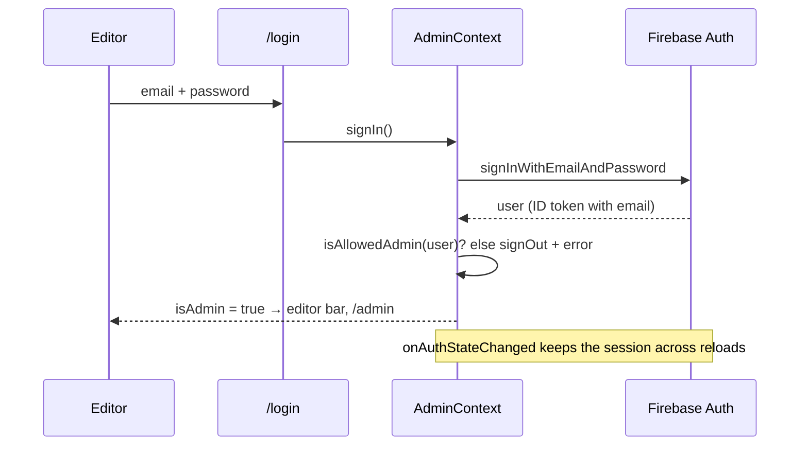
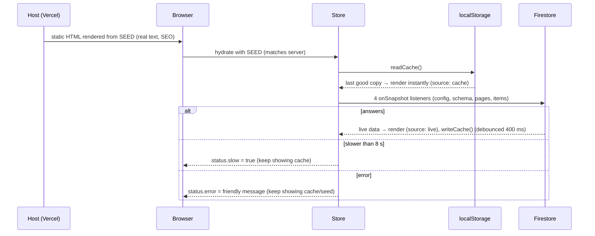
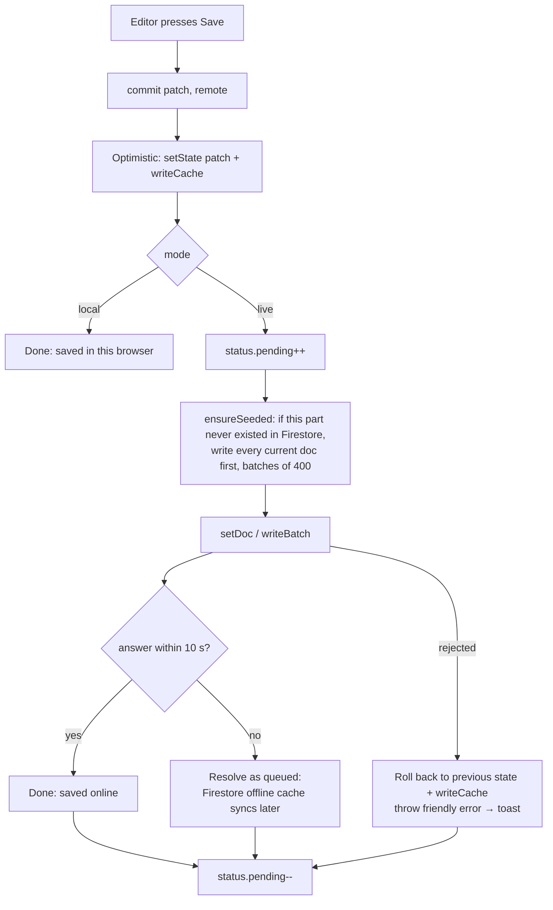
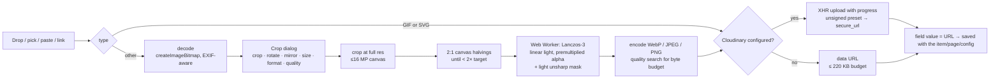
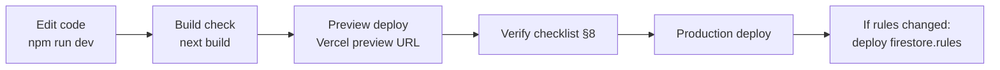

# Architecture and Integration Pipeline

How the website is put together end to end: the frontend UI layers, the backend (Firebase + Cloudinary), and the pipelines that connect them (reading, saving, publishing, images, messages, theming, deployment).

Companion document: [DESIGN_SYSTEM.md](DESIGN_SYSTEM.md) covers the visual design. This one covers the moving parts. Both are written so the same system can be rebuilt for another site.

---

## 1. The big picture



There is **no custom backend server**. The Next.js app is static pages plus client JavaScript. Firebase is the backend: Authentication proves who the editor is, Firestore stores everything, and **security rules are the only gatekeeper**. Cloudinary (optional) hosts images.

Design choices this follows from:

| Goal | How |
|---|---|
| Visitors always see the site, even if Firebase is down, blocked or over quota | Three data layers: seed → browser cache → live |
| Search engines see real text | Pages are pre-rendered on the server from the seed |
| The owner edits without a developer | Every piece of content and design lives in Firestore documents the browser can write (when signed in) |
| Works with zero setup | "Local mode": no env vars needed, edits saved in the browser, publishable later |
| Cheap to run | Firebase Spark (free) + Vercel Hobby + Cloudinary free tier |

---

## 2. Frontend architecture

### 2.1 Routes

| Route | File | Rendering |
|---|---|---|
| `/` | `app/page.js` → `<PageView slug="home">` | Static (SSG) |
| `/[slug]` | `app/[slug]/page.js` | SSG for every seed tab via `generateStaticParams`; `dynamicParams = true` renders tabs added later on demand; `generateMetadata` reads title/description from the seed |
| `/admin` | `app/admin/page.js` | Static shell, client-only content behind auth; section in the URL (`?tab=content&list=publications`) |
| `/login` | `app/login/page.js` | Static, client-only form |
| any | `app/template.js` | Re-mounted on each navigation, plays the page-enter animation |
| 404 | `app/not-found.js` | Static |

### 2.2 Component tree

```
app/layout.js            <html style={seed theme vars}> + Google Fonts <link id="tfs-fonts">
└─ Providers
   ├─ AdminProvider          who is signed in, edit mode, which editor is open
   │  └─ DrawerProvider      side-panel stack + URL sync (?view=…)
   │     ├─ Boot             starts the store; writes the live theme onto <html>
   │     ├─ NavProgress      top progress bar on link clicks
   │     ├─ Navbar           (hidden on /admin)
   │     ├─ <main id="main"> → template → route content
   │     ├─ Footer           (hidden on /admin)
   │     ├─ Drawer           side panel / phone bottom sheet
   │     ├─ SectionEditor, AddSectionDialog, ItemEditor, PageSettingsDialog   (global editors)
   │     ├─ AdminBar         floating editor bar (hidden on /admin)
   │     ├─ CursorFx         pointer styles
   │     ├─ TooltipLayer     hover help
   │     └─ Toaster          notifications
```

Global editors live at the top level so any page, section or list can open them through `AdminContext` (`setSectionEdit`, `openItemEditor`, `setAddSection`, `setPageSettings`) without prop drilling.

### 2.3 State: three kinds, kept apart

| Kind | Where | Examples |
|---|---|---|
| **Content and design** (shared, persistent) | `lib/store.js` external store, read with `useSyncExternalStore` hooks | config, schema, pages, items, status |
| **Session UI** (who / what is open) | React contexts | `AdminContext`: user, editMode, open editors; `DrawerContext`: panel stack, width |
| **Per-visitor preferences** | `localStorage`, read defensively (`safeLocalStorage`, try/catch) | drawer side and width, sheet heights, editor-bar position, dashboard sidebar collapsed, guides seen, last backup |

Store hooks: `useConfig()`, `useSchema()`, `useStatus()`, `usePagesMap()`, `useItemsMap()`, `usePages({ includeHidden })`, `usePage(id)`, `useCollectionDef(key)`, `useCollectionItems(key, { includeHidden, sort })`. Server render uses the `INITIAL` (seed) snapshot, so the server and the first client render always match (no hydration mismatch).

### 2.4 Rendering pipeline for one tab



- **Normalisation** (`lib/sections.js`): every section and page is merged with defaults at render time, so old saved data keeps working when new options are added.
- **Roles** (`lib/roles.js`): `readItem(item, collectionDef)` turns an item into `{ title, subtitle, meta[], date, group, badge, body, image, links[], tags[], details[] }`. Layouts only know roles, never field names, so any collection works in any layout.
- **ErrorBoundary per section**: a broken section disappears for visitors; editors see the error and the section name.
- **Edit mode** adds `SectionToolbar`, insert points and a draft overlay (the section being edited renders from the editor's draft, live).

### 2.5 Forms are generated, not hand-written

Section, item, page and design forms are declared as data and rendered by `components/editor/Fields.js`:

```js
{ key: 'props.imageSide', label: 'Image position', type: 'segmented',
  options: ['none','left','right','top'], help: '…', when: (s) => s.props.image }
```

Field types: `text, textarea, markdown, number, range, toggle, segmented, select, color, image, gallery, icon, list (repeatable sub-forms), blocks, collection, field, field-value, field-multi, items (hand-picked), action-target, mode, tags, date, url`. Adding a design option = one declaration line + reading it in the renderer.

### 2.6 Side panel (drawer) state machine

- `open(view)` pushes onto the stack **and** `history.pushState` with `?view=item:<id>` or `?view=page:<slug>`.
- `back()` pops and `replaceState`s. `close()` unwinds exactly the history entries it pushed (`history.go(-n)`), or cleans the URL if the panel came from a shared link.
- `popstate` re-syncs the stack (browser Back closes or steps back).
- `dismiss()` clears without touching history (used just before navigating to a full page).
- First load reads `?view=` so shared links open the panel.

### 2.7 Two UI kits on purpose

| | Public site | Admin tools |
|---|---|---|
| Scope | everything outside `.ui` | any element inside `.ui` (dashboard, editors, dialogs, editor bar, tooltips) |
| Colours | theme CSS variables (13 tokens, tones) | fixed slate + jade palette |
| Fonts | theme heading/body fonts | system sans 14px |
| Classes | Tailwind with `bg / ink / accent / line…`, `.btn` | `.ui-input, .ui-btn(-accent/-primary/-danger), .ui-icon-btn, .ui-seg, .ui-card, .ui-label, .ui-help` |
| Effects | pointer styles, reveals | none (system pointer), tooltips |

This keeps editing readable on every theme, including dark ones, and stops theme experiments from breaking the tools used to fix them.

---

## 3. Backend

### 3.1 Services

| Service | Used for | Required? |
|---|---|---|
| Firebase Authentication (Email/Password) | Editor sign-in | Only for live mode |
| Cloud Firestore | All content, design, messages | Only for live mode |
| Firestore security rules | Authorisation | Yes, with Firestore |
| Cloudinary (unsigned upload preset) | Image hosting + on-the-fly resizing (`w_,f_auto,q_auto`) | Optional |
| Vercel (or any Next.js host) | Static pages + JS | Yes |

Firebase SDK is **lazy-loaded** (`import('./firebase')`, `import('firebase/firestore')`) only when needed, so visitors in local mode or before the network answers never download it eagerly. `getFirebase()` never throws: missing env vars, blocked network or no IndexedDB all return `null` → the app stays on fallback data. Firestore uses `persistentLocalCache` with multi-tab manager (offline persistence), falling back to the default cache.

### 3.2 Firestore data model

```
site/config          one document  - site-wide settings and design
site/schema          one document  - collection (content type) definitions
pages/{slug}         one per tab   - tab settings + ordered sections array
items/{autoId}       one per entry - every content item, tagged with `collection`
messages/{autoId}    contact form submissions
```

**site/config**

```js
{
  site:    { title, description, language },
  brand:   { name, mark, showMark },
  person:  { honorific, name, position, affiliation, citeAs, photo },
  contact: { email, phone, address, office, hours, mapUrl },
  socials: [{ label, url, icon }],
  theme:   { preset, custom?: { '--accent': '#…', … }, fonts: { heading, body }, radius, baseSize, container },
  nav:     { maxVisible, sticky, align },
  footer:  { line, note, showSocials },
  drawer:  { side, width, itemClick },
  effects: { cursor, cursorStyle, scroll },
}
```

**site/schema**

```js
{ collections: {
    publications: {
      label: 'Publications', singular: 'Publication', icon: 'BookOpen',
      fields: [
        { key: 'title', label: 'Title', type: 'text', role: 'title' },
        { key: 'year', label: 'Year', type: 'number', role: 'date' },
        { key: 'type', label: 'Type', type: 'select', options: ['Journal','Conference',…], role: 'group' },
        …
      ],
      sort: { field: 'year', dir: 'desc' },
    },
    … } }
```

**pages/{slug}** (document id = URL slug; `home` = `/`)

```js
{ title, navLabel, navIcon, order, inNav, hidden,
  header: { show, title, subtitle, align, tone },
  seo: { title, description },
  sections: [ { id, kind, hidden, heading: {…}, props: {…}, style: {…}, viewAll: {…} }, … ] }
```

**items/{id}**

```js
{ collection: 'publications', order, hidden, createdAt, updatedAt, /* + the collection's fields */ }
```

**messages/{id}**

```js
{ name, email, subject, message, createdAt, read }
```

Why this shape:
- **Few reads**: four listeners (config, schema, pages, items) load the whole site; a small academic site is a few hundred documents.
- **Sections inside the page document**: a tab loads and saves atomically; ordering is just the array order.
- **Items in one flat collection**: one listener, cross-collection features (stats counting, hand-picked lists) are trivial, and new content types need no new Firestore collection or rules.
- **Limits**: 1 MB per document. Keep inline (data-URL) images small (220 KB budget) and prefer Cloudinary for many images.

### 3.3 Security rules (`firestore.rules`)

```
rules_version = '2';
service cloud.firestore {
  match /databases/{database}/documents {

    // ---- Who is asking -------------------------------------------------
    // Email must be verified, so nobody can claim an admin's address by
    // registering it first.
    function signedIn() {
      return request.auth != null
        && request.auth.token.email != null
        && request.auth.token.email_verified == true;
    }
    function me() { return request.auth.token.email.lower(); }

    // Super admin: fixed here and in SUPER_ADMIN_EMAILS.
    function isSuper() { return signedIn() && me() in ['owner@example.com']; }

    // Admins: admins/{lower-case email} = { active, perms: {...} }, written by the super admin.
    function adminPath() { return /databases/$(database)/documents/admins/$(me()); }
    function isActiveAdmin() { return signedIn() && exists(adminPath()) && get(adminPath()).data.active == true; }
    function perms() { return get(adminPath()).data.perms; }
    function can(p) { return isSuper() || (isActiveAdmin() && perms().get(p, false) == true); }
    function canList(c) {
      return isSuper() || (isActiveAdmin()
        && (perms().get('content', []) == 'all' || c in perms().get('content', [])));
    }

    // Permanent deletion only within 10 minutes of re-entering the password.
    function recentlyVerified() {
      return request.auth.token.auth_time > request.time.toMillis() / 1000 - 600;
    }

    // ---- Access control (super admin only; an admin may read only their own entry)
    match /admins/{email} {
      allow read: if isSuper() || (signedIn() && me() == email);
      allow write: if isSuper();
    }

    // ---- Site settings
    match /site/config {
      allow read: if true;
      allow create, update: if can('design');
      allow delete: if isSuper() && recentlyVerified();
    }
    match /site/schema {
      allow read: if true;
      allow create, update: if can('lists');
      allow delete: if isSuper() && recentlyVerified();
    }

    // ---- Tabs: section editors may only change `sections` and `trash`
    match /pages/{id} {
      allow read: if true;
      allow create, delete: if can('tabs');
      allow update: if can('tabs')
        || (can('sections') && request.resource.data.diff(resource.data).affectedKeys().hasOnly(['sections', 'trash']));
    }

    // ---- List entries: per list. "Delete" moves to the Bin (an update);
    // removing for good needs the purge permission and a fresh password.
    match /items/{id} {
      allow read: if true;
      allow create: if canList(request.resource.data.collection);
      allow update: if canList(resource.data.collection) && canList(request.resource.data.collection);
      allow delete: if canList(resource.data.collection) && can('purge') && recentlyVerified();
    }

    // ---- Contact form: visitors may create a bounded message.
    match /messages/{id} {
      allow create: if request.resource.data.keys().hasOnly(['name','email','subject','message','createdAt','read'])
        && request.resource.data.name is string && request.resource.data.name.size() < 200
        && request.resource.data.email is string && request.resource.data.email.size() < 200
        && request.resource.data.message is string && request.resource.data.message.size() < 5000;
      allow read, update: if can('messages');
      allow delete: if can('messages') && can('purge') && recentlyVerified();
    }
  }
}
```

- The Firebase web config (API key etc.) is **public by design**; the rules are the real protection.
- `NEXT_PUBLIC_ADMIN_EMAILS` only controls the UI (who gets the editor). If it is empty, any signed-in user sees the editor, but **writes still fail unless the rules allow their email**. Keep the two lists identical. For several editors or roles, switch to custom claims (`request.auth.token.admin == true`) set by a one-off admin script.
- Messages: visitors can only **create** a bounded document; only the admin can read them.
- **Bin and permanent deletion**: everyday deletes of tabs and list entries only set `deletedAt` (moved to the Bin, restorable); sections go to `page.trash` (last 10 per tab). "Delete forever", "Empty the Bin", deleting a whole list, restoring/resetting, deleting messages and "Erase everything" call `requirePassword()` (`components/ui/PasswordGate.js`): live mode re-authenticates with the Firebase password (`reauthenticateWithCredential`, then `getIdToken(true)`), local mode uses a salted SHA-256 deletion password stored in the browser; 5-minute grace after a correct password; 5 wrong attempts lock for a minute. The rules above refuse `delete` on `site`, `items` and `messages` unless `auth_time` is within 10 minutes, so the protection is enforced on the server.

- Index: the inbox query `orderBy('createdAt','desc')` uses an automatic single-field index; no composite indexes are needed.

### 3.4 Authentication flow



Local mode (no Firebase): `/login` offers "Local editor", stored in `sessionStorage` (`tfs:local-editor`), so editing works for trying the site; nothing leaves the browser.

Edit mode is remembered in `localStorage` (`tfs:edit-mode`) and only applies while signed in.

---

## 4. Integration pipelines

### 4.1 Read pipeline (every visit)



- Remote config/schema are **deep-merged over the seed** (`normalizeConfig`, `normalizeSchema`), so a new setting added in code gets its default even before the owner saves.
- `status.empty[part]` records which parts do not exist in Firestore yet (fresh project).
- An unknown slug while still on the seed layer in live mode shows a quiet placeholder instead of "not found", until the database answers.

### 4.2 Write pipeline (every save)



- Every write API (`saveConfig, saveSchema, savePage, savePages, deletePage, saveItem, saveItems, deleteItem, deleteItems, replaceAll`) goes through `commit()`: the UI updates instantly and is reverted if the server refuses.
- `stripUndefined` before every write (Firestore rejects `undefined`).
- Renaming a tab address = one batch: set the new id, delete the old.
- Friendly errors: `permission-denied` → "check firestore.rules", `unavailable`, `resource-exhausted` (quota), `unauthenticated` (sign in again).
- The editor bar and dashboard show `pending` as "Saving…" and warn before signing out with unsaved writes.

### 4.3 Editing pipelines

**Section edit**: open → the section is copied into `sectionEdit.draft` → the page renders the draft live → Save writes the whole page document (`savePage`) → Cancel discards the draft. Same pattern for adding a section (the draft is inserted at the chosen index).

**Item edit**: `ItemEditor` modal with the collection's fields → `saveItem` (new id `<prefix>-<random>`, `createdAt`/`updatedAt`) → every section showing that collection updates through the store.

**Design**: the Design panel edits a local copy, **previews by writing theme variables onto `<html>` directly** (not saved), Save → `saveConfig`, leaving without saving restores the saved theme.

**Schema**: "Fields" edits `site/schema`; new collections appear in every list layout immediately, items need no migration (missing fields read as empty).

### 4.4 Theme pipeline

```
config.theme ──► themeVars(theme) ──► CSS variables on <html>
                   ├─ 13 colour tokens (+ --base-* copies for tones)
                   ├─ --font-heading / --font-body (with script fallback font)
                   └─ --radius, --base-size, --container
config.theme.fonts ──► fontsHref() ──► <link id="tfs-fonts" href="fonts.googleapis.com/css2?family=…&display=swap">
```

- Server: `app/layout.js` writes the **seed** theme inline on `<html>` (first paint already styled, no flash).
- Client: `Boot` re-applies whenever `config.theme` changes (live data, or design preview) and sets `color-scheme` from background luminance.
- Tailwind classes point at the variables, so no rebuild is needed for a theme change.

### 4.5 Image pipeline



Display: `SafeImage` adds Cloudinary transforms (`/upload/w_1200,f_auto,q_auto/`), lazy loading, `referrerPolicy="no-referrer"`, and an initials placeholder on failure. Re-editing an existing image fetches it with CORS; hosts that refuse CORS get a clear message ("download it and drop the file instead").

### 4.6 Contact form pipeline

```
Visitor form ──► honeypot field "website" (bots fill it → silently ignored)
             ──► 30 s client throttle between sends
             ──► sendMessage(): trims to rule limits (name/email 190, subject 300, message 4900), adds createdAt, read:false
             ├─ live: addDoc(messages) (10 s timeout → queued)
             ├─ local: prepended to localStorage tfs:messages:v1
             └─ failure: visitor is offered a mailto: link with the message pre-filled
Dashboard ──► watchMessages(): onSnapshot(messages orderBy createdAt desc) → inbox + unread badge
          ──► updateMessage (read/unread), removeMessage
```

No email notification is sent by default. To add one: the Firebase "Trigger Email" extension or a Cloud Function on `messages` create (requires the Blaze plan).

### 4.7 Publishing and migration pipelines

| Situation | Pipeline |
|---|---|
| **Fresh Firebase project** | Sign in → Dashboard → Data and backups → **Publish**: `replaceAll(exportData())` writes config, schema, all pages and items in batches of 400. Alternatively the first save of any part runs `ensureSeeded` for that part. |
| **Worked in local mode, now going live** | Data panel "switch to live" stores the local export as a pending bundle (`tfs:pending-publish`), reloads in live mode, and offers to publish that bundle. |
| **Backup** | `exportData()` → JSON `{ version, exportedAt, config, schema, pages, items }` download. Overview checklist reminds monthly. |
| **Restore** | Pick a backup → validate (`pages` and `items` present) → confirm → `replaceAll(data)`: sets everything and **deletes Firestore documents not in the backup**. |
| **Reset** | Restore from `seedSnapshot()` (the bundled starting content). |
| **Cache trouble** | `clearCache()` removes the browser copy; the next load rebuilds it from live data. |

### 4.8 Navigation performance pipeline

- Seed tabs are pre-rendered (SSG); `next/link` prefetches them while visible, so switching tabs is instant in production.
- `NavProgress` gives immediate feedback on every internal click; `template.js` plays the page-enter animation.
- Dev mode compiles routes on first visit and never prefetches: judge speed with `next build && next start`.

---

## 5. Environment and setup

### 5.1 Variables (`.env.local`, and the same in the host's settings)

```
FIREBASE_API_KEY=
FIREBASE_AUTH_DOMAIN=
FIREBASE_PROJECT_ID=
FIREBASE_STORAGE_BUCKET=
FIREBASE_APP_ID=
SUPER_ADMIN_EMAILS=owner@example.com      # super admin(s); must match isSuper() in firestore.rules
CLOUDINARY_CLOUD_NAME=                    # optional
CLOUDINARY_UPLOAD_PRESET=                 # optional, unsigned preset
```

They use plain names and are passed to the app by `next.config.mjs` (`env`), because the browser talks to Firebase and Cloudinary directly; none is a secret (the rules protect the data). The older `NEXT_PUBLIC_…` names still work as a fallback. Leave the Firebase ones empty to run in local mode. Changing env vars requires a rebuild/redeploy (they are inlined at build time).

### 5.2 One-time setup

1. **Firebase**: create project → Authentication → enable Email/Password → add the editor's user → Firestore → create database (production mode, nearest region) → Project settings → add a Web app → copy keys.
2. **Rules**: put the editor email in `isAdmin()` → publish (console, or `firebase deploy --only firestore:rules`).
3. **Cloudinary** (optional): Settings → Upload → add an **unsigned** upload preset (restrict to images, max file size, a folder name) → copy cloud name + preset.
4. **Local run**: `npm install`, `.env.local`, `npm run dev`, sign in at `/login`, Dashboard → Data → **Publish** once.
5. **Hosting (Vercel)**: import the project, add the env vars, deploy. In Firebase Authentication → Settings → Authorized domains, add the production domain.

### 5.3 Development and release pipeline



- **Never run `next build` in the same folder while `next dev` is running** (both use `.next`; the dev server breaks with `reading 'call'`). Build in a copy, or stop dev and delete `.next` first.
- Content changes **do not need a deploy**: they live in Firestore. Only code, the seed (for SEO metadata and first paint), env vars and rules need releases.
- Periodically copy the live content back into `src/data/seed.js` (Dashboard → Data → download backup, then paste) so first paint and search metadata match the live site.

---

## 6. Failure handling matrix

| Failure | What visitors see | What editors see |
|---|---|---|
| Firebase not configured | Seed content | Local mode badge; edits stay in this browser |
| Firebase blocked / offline | Cache, else seed | Red "Offline" status; saves rejected with a message, or queued |
| Slow database (>8 s) | Cache | Amber "Database is slow" |
| Quota exceeded | Cache | "Firebase quota reached for today" |
| Permission denied on save | — | Change rolled back + "check firestore.rules" |
| Save not confirmed in 10 s | — | "Saved on this device, will sync" (Firestore offline queue) |
| Broken image URL | Initials placeholder | Same, plus faded preview in the field |
| A section throws | Section hidden | Error card with the section name |
| Contact form cannot send | mailto link with the message pre-filled | — |
| Unknown tab address | Quiet placeholder until live data, then "This tab does not exist" | Same |

---

## 7. Security notes

- Rules are the only server-side check; test them in the Firebase Rules Playground (anonymous read OK, anonymous write denied, admin write allowed, message create with extra keys denied).
- Admin-only features that inject markup (Free layout "HTML" block, section custom CSS) are trusted because only the admin can write them. Never expose them to visitor input.
- Markdown links to other sites open with `rel="noopener noreferrer"`; images use `referrerPolicy="no-referrer"`.
- The Cloudinary preset is unsigned (anyone with it could upload): restrict it to images, a max size and a folder, and rotate it if abused.
- Messages are size-bounded by rules; add App Check or reCAPTCHA if spam appears.

---

## 8. Extending the system

| Want | Change |
|---|---|
| A new design option for every section | One line in `STYLE_FIELDS` (`lib/sections.js`) + read it in `SectionFrame.js` |
| A new section type | Entry in `KINDS` (defaults + fields + label) + component in `components/sections/index.js` |
| A new content type | Dashboard → Content → New list (no code), or add it to `seed.schema` |
| A new site-wide setting | Default in `seed.config` (auto-merged into live config) + a field in `DesignPanel` + read with `useConfig()` |
| A new admin section | Entry in `SECTIONS` (`AdminShell.js`: id, group, icon, tip, summary, guide) + panel component + case in `app/admin/page.js` |
| Email on new message | Firebase Trigger Email extension or Cloud Function on `messages/{id}` create |
| Several editors with roles | Custom claims + rules on `request.auth.token.role` |
| Version history | Write a copy to `history/{part}/{timestamp}` inside `commit()` before overwriting |
| Server-rendered live content (SEO from Firestore) | Use the Firebase Admin SDK in `generateMetadata` / server components with ISR (`revalidate`), keeping the seed as fallback |

---

## 9. Reuse checklist for a new project

1. Copy the project; replace `src/data/seed.js` (config, schema, pages, items) with the new client's content.
2. Pick a preset and fonts; adjust nav icon guesses for the new tab names.
3. New Firebase project + rules with the new editor email; new Cloudinary preset (optional).
4. `.env.local` + host env vars; add the domain to Firebase authorized domains.
5. `npm run dev` → sign in → Data → Publish.
6. Build check, preview deploy, run the verification list in DESIGN_SYSTEM.md §16, production deploy.
7. Hand over: show the owner the dashboard Overview checklist and "How this works" guides; give them a first backup file.
